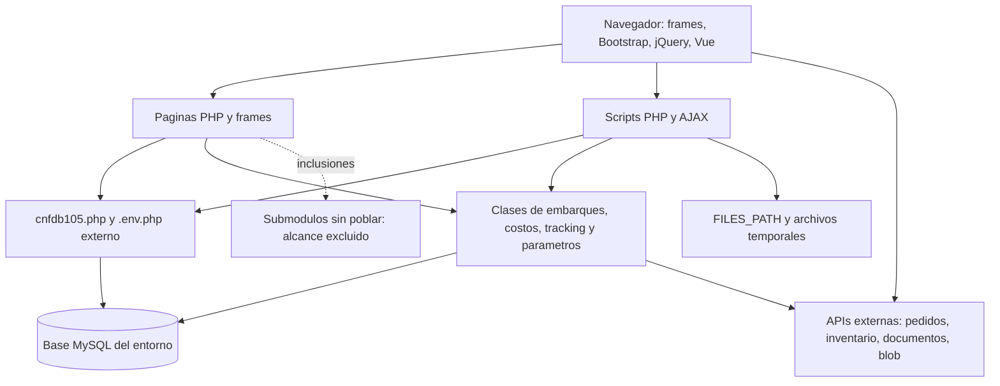

# Arquitectura observada

Auditoria estatica 2026-11-18. M = `a8ce2c23dead8552d2c4699e4a9b9134f7a18707`; P = `95fe9a4c3b3cddd84be922cc0e1eb9c88603df62`. Se leyeron archivos y diffs de esos objetos en `C:/repos/proveedores-github-review-20261118`. [Alcance y comparacion](../variants/README.md).

## Estructura real

La aplicacion es PHP organizado principalmente en scripts accesibles directamente, paginas que incluyen otros PHP, clases estaticas con SQL y controladores AJAX. La entrada es un frameset con `mainFrame` y un pie. No se observa un unico front controller que despache todas las rutas: `embarquesController.php` recibe `accion`/POST directamente y los listados tienen endpoints propios ([M entrada, L57-L82](https://github.com/KPO-Group/proveedores/blob/a8ce2c23dead8552d2c4699e4a9b9134f7a18707/index.php#L57-L82); [M controlador, L9-L45](https://github.com/KPO-Group/proveedores/blob/a8ce2c23dead8552d2c4699e4a9b9134f7a18707/index_archivos/embarques/embarquesController.php#L9-L45); [P endpoint de lista, L40-L48](https://github.com/KPO-Group/proveedores/blob/95fe9a4c3b3cddd84be922cc0e1eb9c88603df62/index_archivos/embarques/ajax/listaEmbarques.php#L40-L48)).

Las paginas combinan PHP, Bootstrap, jQuery/DataTables y componentes Vue, con iframes que se cargan al abrir pestanas. Por ejemplo, el detalle de embarque incluye inventario, items, documentos, costos y estado de pedidos. P agrega manejo de carga de frames y amplia algunos perfiles visibles ([M pestanas/frames, L316-L391](https://github.com/KPO-Group/proveedores/blob/a8ce2c23dead8552d2c4699e4a9b9134f7a18707/index_archivos/embarques/embarquever.php#L316-L391); [P frames dinamicos, L95-L105](https://github.com/KPO-Group/proveedores/blob/95fe9a4c3b3cddd84be922cc0e1eb9c88603df62/index_archivos/embarques/embarquever.php#L95-L105); [M Vue y contexto, L70-L92](https://github.com/KPO-Group/proveedores/blob/a8ce2c23dead8552d2c4699e4a9b9134f7a18707/index_archivos/embarques/frames/inventario_local.php#L70-L92)).

El diagrama sintetiza dependencias observadas; no representa una topologia de produccion comprobada.

## Capas, slices y acoplamientos

| Superficie | Responsabilidad observada | Evidencia |
| --- | --- | --- |
| Bootstrap | Incluye `.env.php`, autoload de Composer, conexion SQL, zona horaria y cliente Pusher. | [M `cnfdb105.php`, L1-L3](https://github.com/KPO-Group/proveedores/blob/a8ce2c23dead8552d2c4699e4a9b9134f7a18707/index_archivos/cnfdb105.php#L1-L3), [L9-L57](https://github.com/KPO-Group/proveedores/blob/a8ce2c23dead8552d2c4699e4a9b9134f7a18707/index_archivos/cnfdb105.php#L9-L57). |
| Sesion y acceso | Login usa PDO y deja IDs/tipo de proveedor/token en sesion; `permisos.php` comprueba presencia de `idtransportista`. Los enlaces de menu se consultan en tablas de permisos. Esto no prueba autorizacion de objeto en cada endpoint. | [M login, L24-L34](https://github.com/KPO-Group/proveedores/blob/a8ce2c23dead8552d2c4699e4a9b9134f7a18707/index_archivos/veriflogin.php#L24-L34), [L88-L104](https://github.com/KPO-Group/proveedores/blob/a8ce2c23dead8552d2c4699e4a9b9134f7a18707/index_archivos/veriflogin.php#L88-L104); [M permisos, L1-L26](https://github.com/KPO-Group/proveedores/blob/a8ce2c23dead8552d2c4699e4a9b9134f7a18707/index_archivos/permisos.php#L1-L26); [M menu SQL, L25-L40](https://github.com/KPO-Group/proveedores/blob/a8ce2c23dead8552d2c4699e4a9b9134f7a18707/index_archivos/MenuClass.php#L25-L40). |
| Clases de negocio/persistencia | SQL y decisiones de negocio conviven en metodos; guardar cotizacion inserta embarque y llama persistencia de magnitudes, tramos y pedidos. | [M `CotizacionClass.php`, L655-L695](https://github.com/KPO-Group/proveedores/blob/a8ce2c23dead8552d2c4699e4a9b9134f7a18707/index_archivos/embarques/CotizacionClass.php#L655-L695). |
| Slice de usuarios en `src/` | Ruta con nomenclatura de aplicacion/Find y namespace comentado; `UserFinder` es una clase estatica con SQL, includes y sesion indirecta. El arbol `src/` contiene solo este archivo y `config.php` en ambos pins. Es un indicio de organizacion tipo DDD, no una arquitectura DDD completa ni capas de dominio/repositorio demostradas. | Inventario `git ls-tree -r <pin> -- src/`; [M adaptador, L3-L38](https://github.com/KPO-Group/proveedores/blob/a8ce2c23dead8552d2c4699e4a9b9134f7a18707/src/core/users/application/Find/UserFind.php#L3-L38); [P adaptador, L3-L40](https://github.com/KPO-Group/proveedores/blob/95fe9a4c3b3cddd84be922cc0e1eb9c88603df62/src/core/users/application/Find/UserFind.php#L3-L40). |
| Integraciones | Hay llamadas servidor-servidor y navegador-API; gran parte del inventario y pedidos P depende de codigo fuera del repositorio. | [P conversion API, L582-L605](https://github.com/KPO-Group/proveedores/blob/95fe9a4c3b3cddd84be922cc0e1eb9c88603df62/index_archivos/embarques/js/datosPedidos.js#L582-L605); [P proxy blob, L83-L103](https://github.com/KPO-Group/proveedores/blob/95fe9a4c3b3cddd84be922cc0e1eb9c88603df62/index_archivos/tracking/getVideo.php#L83-L103). |

## Diferencias que alteran la arquitectura operativa

P agrega gestion dedicada de pedidos/preembarques y un flujo local para crear viajes desde items que reutiliza `CargaMasiva`. Tambien agrega el proxy de video con cache temporal, bloqueo y streaming por rangos. M y P comparten organizacion general, pero tienen dependencias distintas de columnas SQL, contratos API, perfiles y extensiones PHP ([P orquestacion, L256-L283](https://github.com/KPO-Group/proveedores/blob/95fe9a4c3b3cddd84be922cc0e1eb9c88603df62/index_archivos/embarques/ajax/crear-viaje-desde-items.php#L256-L283); [P cache y streaming, L151-L204](https://github.com/KPO-Group/proveedores/blob/95fe9a4c3b3cddd84be922cc0e1eb9c88603df62/index_archivos/tracking/getVideo.php#L151-L204)).

M incorpora `conexionMysqli()` y un acceso mysql condicionado; P conecta directamente con `mysql_connect`. Ambos usan PDO en login. La imagen versionada sigue declarando PHP 5.4 en ambos pins. El chequeo local de sintaxis con PHP 8.4.25 y `short_open_tag` activado es una actividad distinta: el [artefacto de lint](../../source-audits/master/2026-11-18/php-lint.json) registra 279 archivos y tres fallos, con `executed_application: false`. No valida ejecucion, extensiones, argumentos de funciones, consultas ni servicios ([M puente, L13-L49](https://github.com/KPO-Group/proveedores/blob/a8ce2c23dead8552d2c4699e4a9b9134f7a18707/index_archivos/cnfdb105.php#L13-L49); [P conexion, L13-L24](https://github.com/KPO-Group/proveedores/blob/95fe9a4c3b3cddd84be922cc0e1eb9c88603df62/index_archivos/cnfdb105.php#L13-L24); [P login PDO, L23-L33](https://github.com/KPO-Group/proveedores/blob/95fe9a4c3b3cddd84be922cc0e1eb9c88603df62/index_archivos/veriflogin.php#L23-L33); [M Docker, L1-L6](https://github.com/KPO-Group/proveedores/blob/a8ce2c23dead8552d2c4699e4a9b9134f7a18707/Dockerfile#L1-L6)).

M cambia enlaces externos a OpenSSL donde P mantiene mcrypt. P elimina dos guardas de descarga/imagen de M. Esas divergencias tecnicas no deben tratarse como simples adaptaciones nacionales ([M cifrado, L11-L54](https://github.com/KPO-Group/proveedores/blob/a8ce2c23dead8552d2c4699e4a9b9134f7a18707/index.php#L11-L54); [P cifrado, L59-L70](https://github.com/KPO-Group/proveedores/blob/95fe9a4c3b3cddd84be922cc0e1eb9c88603df62/index.php#L59-L70); [comparacion de guardas](../variants/comparison.md)).

## Despliegue y alcance excluido

`.env.php` y `index_archivos/vendor/` no estan versionados. El bootstrap requiere ambos y Composer declara Pusher, Carbon y Guzzle. Su instalacion/configuracion efectiva queda fuera de lo probado ([M exclusiones, L1-L3](https://github.com/KPO-Group/proveedores/blob/a8ce2c23dead8552d2c4699e4a9b9134f7a18707/.gitignore#L1-L3); [M autoload, L1-L3](https://github.com/KPO-Group/proveedores/blob/a8ce2c23dead8552d2c4699e4a9b9134f7a18707/index_archivos/cnfdb105.php#L1-L3); [M dependencias, L1-L12](https://github.com/KPO-Group/proveedores/blob/a8ce2c23dead8552d2c4699e4a9b9134f7a18707/index_archivos/composer.json#L1-L12)).

Los dos submodulos `intercambioDocumental` y `servicioNotificaciones` estan sin poblar y cambian de gitlink entre pins. Sus contenidos se excluyen. Se observan inclusiones para tipos de empresa, scripts Pusher y componentes de notificaciones, pero no se infiere su implementacion ni equivalencia ([M submodulos, L1-L8](https://github.com/KPO-Group/proveedores/blob/a8ce2c23dead8552d2c4699e4a9b9134f7a18707/.gitmodules#L1-L8); [M inclusion Pusher, L419-L421](https://github.com/KPO-Group/proveedores/blob/a8ce2c23dead8552d2c4699e4a9b9134f7a18707/index_archivos/embarques/embarquever.php#L419-L421); [pins exactos](../variants/comparison.md#submodulos-fuera-de-alcance)). No se descargaron fuentes externas.

## Estado de validacion

Se comprobaron pins, arboles, igualdad de blobs, diffs y referencias a lineas. No se desplego la aplicacion, no se conecto una base de datos ni se probaron APIs. Un archivo identico puede ejecutar comportamiento diferente al recibir otros permisos, catalogos, funciones SQL o variables de entorno.

Los artefactos actuales de master son distintos de los historicos Peru: [Brownfield](../../source-audits/master/2026-11-18/brownfield/evidence/summary.json) registra 1,091 evidencias; [Graphify AST](../../source-audits/master/2026-11-18/graphify/summary.json) registra 545 archivos, **2,173 nodos y 2,711 aristas**, con 319 archivos sin simbolos mas alla del nodo de archivo. Son salidas estaticas, no cobertura funcional ni runtime validado. El [catalogo API alternativo](testing.md) registra **241 candidatos expuestos y 20 de consumo**; no son hallazgos nativos ni rutas HTTP comprobadas. La [ejecucion nativa ASGARD](../../source-audits/master/2026-11-18/native-api-execution.json) figura **NOT_RUN** (`not_executed`), bloqueada por Windows Application Control: no se interpreta como cero APIs ni cero hallazgos. El glosario generico autogenerado de tres terminos no se considera un glosario de negocio terminado.
